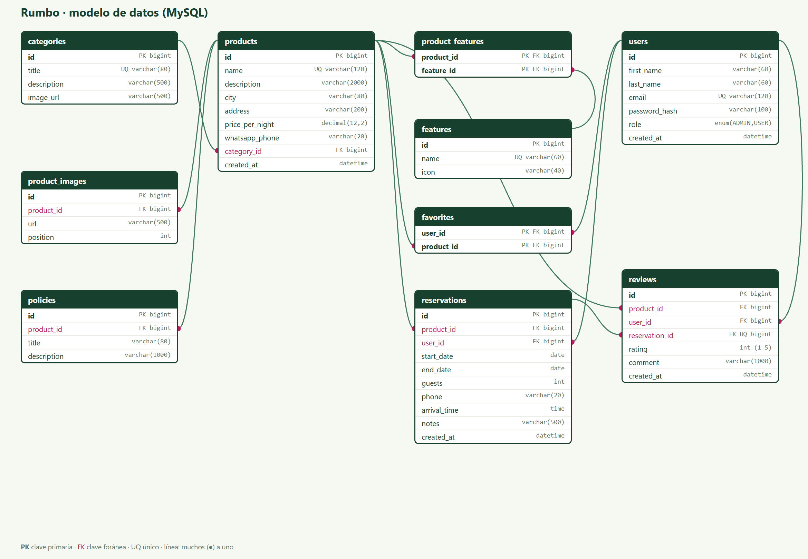
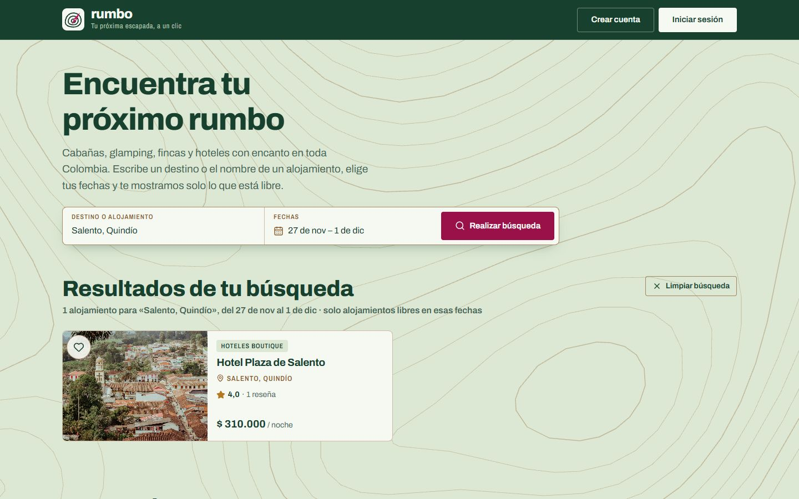
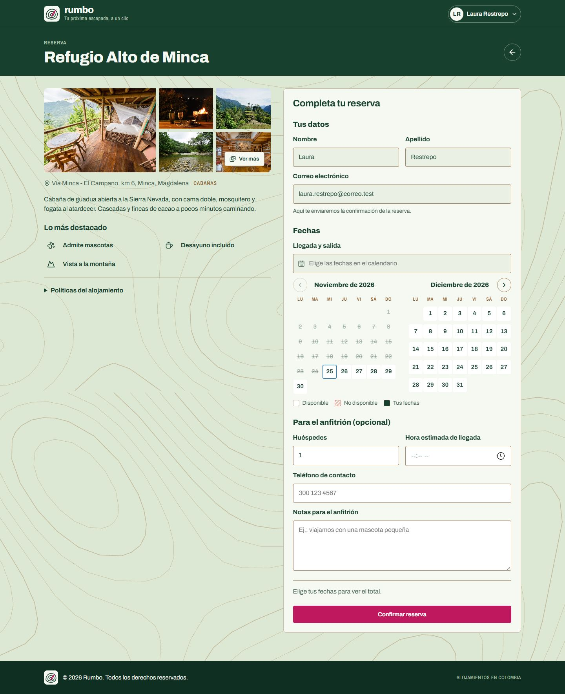
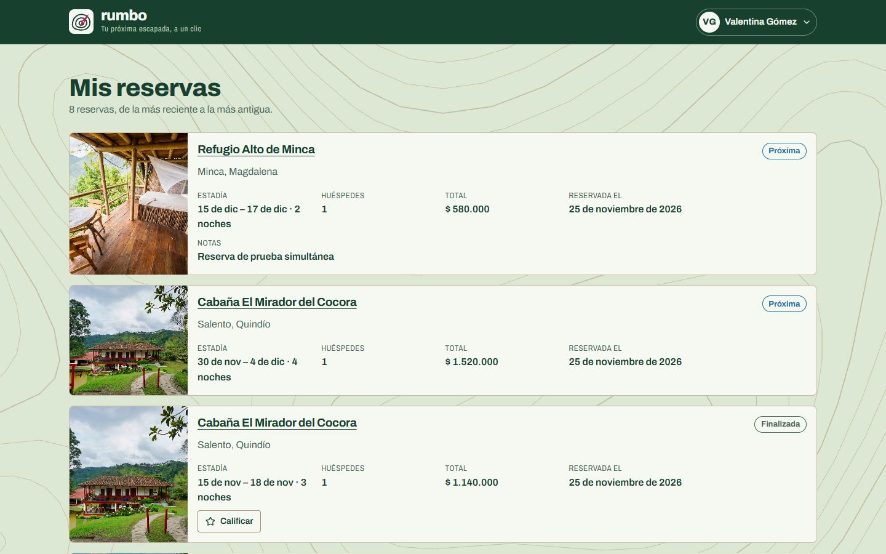
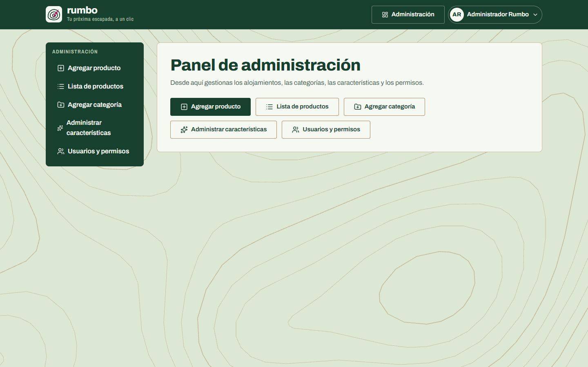

# 🏢 Rumbo

Web de reservas de alojamientos turísticos en Colombia: cabañas, glamping, hoteles boutique, fincas, apartamentos y hostales. Los viajeros buscan por destino y fechas, ven la disponibilidad, guardan favoritos, reservan, reciben la confirmación por correo y califican su estadía. Los administradores gestionan productos, categorías, características, políticas y usuarios.

Proyecto del Desafío Profesional de Digital House, construido en cuatro sprints.

---

## ⚙️ Tecnologías

### 🖥️ Frontend
- React 19.3 + Vite 8.3
- React Router 7.18
- Lucide React 1.80 (íconos) y Sonner 2.0 (avisos)
- CSS propio con tokens de diseño ([`DESIGN.md`](DESIGN.md))
- Vitest 5.1 + Testing Library

### ☕ Backend
- Java 21
- Spring Boot 4.2 (Web MVC, Data JPA, Validation, Mail)
- Spring Security + JWT (jjwt 0.13)
- MySQL 8.4 (H2 en modo MySQL para las pruebas)
- springdoc-openapi 3.2 (Swagger UI)
- Lombok

### 🐳 Servicios locales
- Docker Compose: MySQL 8.4 y Mailpit (bandeja de correo de prueba)

---

## 🚀 Instalación local

### 🧩 Requisitos previos
- Node.js 20 o superior
- Java 21 (JDK). Maven no hace falta: el proyecto trae `mvnw`.
- Docker Desktop (o Docker Engine con Compose)

### 📦 Clonar el repositorio
```bash
git clone https://github.com/CamiloACastanedaM/rumbo-reservas.git
cd rumbo-reservas
```

### 🗄️ Base de datos y correo
```bash
docker compose up -d
```
Levanta MySQL en `localhost:3306` con la base `rumbo` ya creada (usuario `rumbo`, contraseña `rumbo`) y Mailpit, que recibe los correos de la app en http://localhost:8025.

Si usas un MySQL propio en vez de Docker, crea la base antes:
```sql
CREATE DATABASE rumbo;
```
Para cambiar el usuario o la contraseña del contenedor, copia `.env.example` a `.env` en la raíz y edítalo.

---

### 📁 Backend (`/backend`)

```bash
cd backend
cp .env.example .env      # sin JWT_SECRET, las sesiones se cierran cada vez que se reinicia la API
./mvnw spring-boot:run    # en Windows (cmd o PowerShell): mvnw.cmd spring-boot:run
```
> La API queda en `http://localhost:8080` y la documentación en http://localhost:8080/swagger-ui/index.html

Spring lee `backend/.env` al arrancar. Variables:

| Variable | Para qué sirve | Valor de ejemplo |
|---|---|---|
| `DB_URL` | Conexión JDBC a MySQL | `jdbc:mysql://localhost:3306/rumbo` |
| `DB_USERNAME` / `DB_PASSWORD` | Usuario de la base | `rumbo` / `rumbo` |
| `JWT_SECRET` | Clave para firmar los tokens. 32 caracteres o más; genera una propia | — |
| `ADMIN_EMAIL` / `ADMIN_PASSWORD` | Primer administrador, se crea al arrancar si no existe | `admin@rumbo.local` / `Cambiar123` |
| `UPLOAD_DIR` | Carpeta donde se guardan las fotos subidas | `uploads` |
| `CORS_ORIGINS` | Orígenes que pueden llamar a la API | `http://localhost:5173` |
| `FRONTEND_URL` | Base de los enlaces que van en los correos | `http://localhost:5173` |
| `MAIL_HOST` / `MAIL_PORT` / `MAIL_FROM` | Servidor SMTP y remitente (Mailpit en local) | `localhost` / `1025` |

**Datos de ejemplo.** Con la base vacía, la API carga 20 alojamientos con fotos, categorías, características y políticas, más tres usuarios de demostración con estadías y reseñas (contraseña `Viajes2026`: `valentina.gomez@correo.test`, `andres.ruiz@correo.test`, `camila.ortiz@correo.test`). Las tablas se crean solas (`ddl-auto: update`). En producción conviene arrancar con `app.seed=false`.

---

### 🖼️ Frontend (`/frontend`)

```bash
cd frontend
npm install
npm run dev
```
> El sitio queda en `http://localhost:5173`. El panel de administración está en `/administracion`.

Si la API no corre en `localhost:8080`, copia `frontend/.env.example` a `frontend/.env` y ajusta:
```dotenv
VITE_API_URL=http://localhost:8080
```

---

## 📬 Endpoints

Documentación interactiva: http://localhost:8080/swagger-ui/index.html. «Usuario» significa con sesión (token JWT en `Authorization: Bearer …`); «Admin», con rol de administrador.

### Cuentas
| Método | Endpoint | Descripción | Auth |
|---|---|---|---|
| POST | `/api/auth/register` | Crear cuenta (envía correo de bienvenida) | — |
| POST | `/api/auth/login` | Iniciar sesión; devuelve el token | — |
| POST | `/api/auth/resend-confirmation` | Reenviar el correo de bienvenida | — |
| GET | `/api/users/me` | Datos de la sesión actual | Usuario |

### Catálogo y búsqueda
| Método | Endpoint | Descripción | Auth |
|---|---|---|---|
| GET | `/api/products` | Alojamientos al azar, paginados; filtro por categorías | — |
| GET | `/api/products/search` | Búsqueda por texto y fechas libres (`q`, `start`, `end`) | — |
| GET | `/api/products/suggestions` | Sugerencias del buscador | — |
| GET | `/api/products/{id}` | Detalle con fotos, características, políticas, puntuación y WhatsApp | — |
| GET | `/api/products/{id}/availability` | Rangos ocupados | — |
| GET | `/api/categories` | Categorías con su imagen | — |
| GET | `/api/features` | Características con su ícono | — |

### Favoritos y reseñas
| Método | Endpoint | Descripción | Auth |
|---|---|---|---|
| GET | `/api/favorites` | Favoritos del usuario | Usuario |
| POST | `/api/favorites/{productId}` | Marcar favorito | Usuario |
| DELETE | `/api/favorites/{productId}` | Quitar favorito | Usuario |
| GET | `/api/products/{productId}/reviews` | Reseñas, promedio y si el usuario puede calificar | — |
| POST | `/api/products/{productId}/reviews` | Calificar una estadía terminada | Usuario |

### Reservas
| Método | Endpoint | Descripción | Auth |
|---|---|---|---|
| POST | `/api/reservations` | Reservar fechas libres (envía el correo de confirmación) | Usuario |
| GET | `/api/reservations/me` | Historial, de la más reciente a la más antigua | Usuario |

### Administración
| Método | Endpoint | Descripción | Auth |
|---|---|---|---|
| GET | `/api/admin/products` | Lista de productos | Admin |
| POST | `/api/admin/products` | Crear producto con fotos (multipart) | Admin |
| PUT | `/api/admin/products/{id}` | Editar producto | Admin |
| DELETE | `/api/admin/products/{id}` | Eliminar producto | Admin |
| GET | `/api/admin/categories` | Categorías con cantidad de productos | Admin |
| POST | `/api/admin/categories` | Crear categoría con imagen (multipart) | Admin |
| DELETE | `/api/admin/categories/{id}` | Eliminar categoría (sus productos quedan sin categoría) | Admin |
| POST | `/api/admin/features` | Crear característica | Admin |
| PUT | `/api/admin/features/{id}` | Editar característica | Admin |
| DELETE | `/api/admin/features/{id}` | Eliminar característica | Admin |
| GET | `/api/admin/users` | Lista de usuarios | Admin |
| PATCH | `/api/admin/users/{id}/role` | Dar o quitar el rol de administrador | Admin |

---

## 🗂️ Modelo de datos



---

## 🧪 Testing

```bash
cd backend && ./mvnw test     # 27 pruebas: JUnit 5 + MockMvc + Spring Security Test sobre H2
cd frontend && npm test       # 32 pruebas: Vitest + Testing Library
cd frontend && npm run build  # build de producción
```

- **Backend:** pruebas de integración de cada endpoint (validaciones, permisos 401/403, conflictos 409, búsqueda, disponibilidad, reservas y el correo de confirmación con el envío simulado).
- **Frontend:** pruebas de componentes y páginas con la API simulada (formularios, calendario, favoritos, reseñas, reserva, historial y WhatsApp).
- **QA manual por sprint:** planes de prueba con evidencia a 375, 768 y 1440 px en [`docs/qa/`](docs/qa/).

---

## 📸 Capturas

| Búsqueda con fechas | Reserva |
|---|---|
|  |  |
| **Mis reservas** | **Panel de administración** |
|  |  |

---

## 📚 Documentos

- Bitácoras de cada sprint: [`docs/bitacora/`](docs/bitacora/)
- Planes de QA y evidencias: [`docs/qa/`](docs/qa/)
- Entregas en PDF: [`docs/entregas/`](docs/entregas/)
- Despliegue en producción (Railway + Vercel): [`docs/despliegue.md`](docs/despliegue.md)
- Marca: [`docs/brand/brand.md`](docs/brand/brand.md) · Sistema visual: [`DESIGN.md`](DESIGN.md)

---

## 👤 Autor

**Camilo Castañeda** · [GitHub](https://github.com/CamiloACastanedaM)
