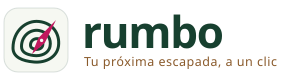

# Identidad visual de Rumbo

## Concepto

**Rumbo** es la dirección que toma un viaje. La marca se inspira en los mapas topográficos de Colombia (las planchas del IGAC y los mapas de senderos): curvas de nivel, rótulos de lugares en mayúsculas espaciadas y una sola línea de color que marca la ruta.

- **Isotipo:** tres curvas de nivel forman una montaña y una aguja de brújula color *Ruta* apunta hacia el noreste: el próximo destino.
- **Logotipo:** isotipo + la palabra «rumbo» en minúsculas, Archivo ExtraBold, con el lema debajo.
- **Lema:** *Tu próxima escapada, a un clic.*

Archivos: [`logo.svg`](logo.svg) (isotipo + logotipo), [`isotype.svg`](isotype.svg) (solo isotipo, también es el favicon) y [`palette.png`](palette.png) (hoja de marca).

## Paleta (6 colores)

| Color | HEX | Rol |
|---|---|---|
| Páramo | `#17402F` | Color de marca: header, footer, texto principal |
| Frailejón | `#DCE8D3` | Fondo principal del sitio, como el verde de un mapa |
| Papel | `#F6F8F2` | Tarjetas, paneles y texto sobre fondo verde |
| Curva de nivel | `#8A5A2B` | Rótulos tipo mapa, líneas de contorno, bordes finos |
| Río | `#1D6FA5` | Enlaces, foco del teclado, información |
| Ruta | `#C0185E` | Solo la acción principal que lleva a reservar (por ejemplo «Realizar búsqueda») |

Regla de uso: el magenta *Ruta* tiene un único trabajo. Si todo es magenta, nada es la ruta.

### Contraste (WCAG)

| Combinación | Contraste | Uso |
|---|---|---|
| Páramo sobre Papel | 10,8 : 1 | Texto normal ✅ AA/AAA |
| Páramo sobre Frailejón | 9,1 : 1 | Texto normal ✅ AA/AAA |
| Papel sobre Páramo | 10,8 : 1 | Header y footer ✅ |
| Blanco sobre Ruta | 5,9 : 1 | Botón principal ✅ AA |
| Curva de nivel sobre Papel | 5,5 : 1 | Rótulos ✅ AA |
| Río sobre Papel | 5,1 : 1 | Enlaces ✅ AA |
| Río sobre Frailejón | 4,3 : 1 | Solo texto grande o íconos |

## Tipografía

- **Archivo** (variable, 100–900): títulos en ExtraBold con interletra apretada y texto corrido en Regular.
- **Archivo Narrow** (600): rótulos en mayúsculas con interletra amplia, como los nombres de lugares en un mapa (ciudad, departamento, categoría, encabezados de tabla).

Ambas son fuentes libres (SIL Open Font License) y se sirven desde el propio sitio (`frontend/public/fonts`), sin depender de servicios externos.

## Elementos gráficos

- **Campo de curvas de nivel:** fondo `contours.svg`, generado a partir de un relieve andino sintético; curvas finas cada nivel y una curva maestra más gruesa cada cuatro, como en una plancha topográfica.
- **Rótulo de mapa:** ícono de pin + `CIUDAD, DEPARTAMENTO` en Archivo Narrow, color Curva de nivel.
- **Módulos con filete:** tarjetas y paneles con borde de 1 px color Curva de nivel al 38 %, sin sombras pesadas.

## Usos

- El logo va sobre Papel o sobre Páramo (el isotipo siempre en su placa Papel con esquinas redondeadas).
- Área de respeto: la altura de la aguja de la brújula alrededor del logo.
- No cambiar los colores del isotipo, no rotarlo y no ponerlo sobre fotos sin la placa.
